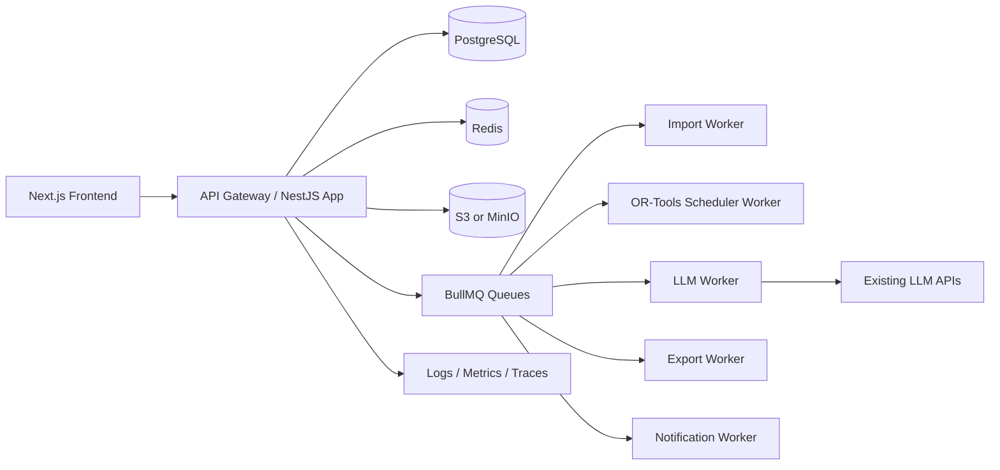

# JKXT V2.0 后端/全栈接入开发文档

版本: 1.0  
日期: 2026-06-05  
状态: 后端联调实施建议稿  
适用范围: `D:\VB\JKXT\JKXT V2.0` 当前前端 UI 原型到真实后端服务的完整打通

## 1. 结论

当前项目已经具备高保真前端 UI 和一部分浏览器内真实闭环，但还不是生产级全栈系统。后端建设应先把现有 UI 的“假动作”落成真实服务，再逐步替换本地状态和 mock 数据。

推荐目标架构:

- 前端: Next.js 14 App Router + TypeScript + Tailwind + shadcn/ui + TanStack Query + Zustand + Zod。
- API 服务: NestJS/Fastify 单体优先，后续可拆服务。若团队更熟 Java，可等价替换为 Spring Boot。
- 数据层: PostgreSQL 16 + Prisma/Drizzle migration，所有业务表带 `tenant_id`。
- 队列: Redis + BullMQ，承载 Excel 导入、排班求解、LLM 解析、导出、通知、备份。
- 排班求解: MVP 保留现有贪心逻辑做兼容，生产版增加 Python OR-Tools CP-SAT worker。
- LLM: 使用服务端 provider adapter 接入已有大模型 API，LLM 只做策略解析、解释、修复建议和摘要，不直接决定最终排班。
- 文件: S3/MinIO 对象存储，存 Excel 原件、校验报告、导出结果、PDF 报表。
- 运维: Docker Compose 起步，生产可迁移 Kubernetes；接入 OpenTelemetry、结构化日志、审计日志、备份与恢复。

第一阶段不要重写所有 UI。先新增 `apiClient` 和 MSW/mock adapter，让页面从 `window.JKXT`、静态数组、`localStorage` 平滑切到真实 API。

## 2. 当前源码证据

| 位置 | 现状 | 后端含义 |
| --- | --- | --- |
| `src/app.jsx` | 路由、登录态、模式和页面状态使用 `localStorage` | 需要 Auth、Session、RoleGuard、TenantContext |
| `src/pages/login.jsx` | 管理员/超管演示登录、验证码和本地模式切换 | 需要真实登录、验证码、首登改密、2FA、锁定策略 |
| `src/pages/quick-engine.jsx` | 浏览器内解析 Excel、校验字段、贪心排班、导出 XLSX、localStorage 任务 | 需要导入服务、校验服务、调度 worker、导出 worker、任务库 |
| `src/pages/quick.jsx` / `quick-step*` | 四步排监考向导，依赖 `window.JKXT` | 需要任务状态机、长任务进度、冲突回传、断点恢复 |
| `src/pages/ai-policy.jsx` | `llm-token / claude-sonnet-4-6` provider、6 条 K-12 策略、自然语言输入 | 已接入 OpenAI 兼容 adapter、prompt 模板、JSON schema 校验与调用审计 |
| `people/classrooms/classes-subjects` | 教师、考场、班级、科目 mock 数据 | 需要租户内基础数据 CRUD、导入、可用性、约束 |
| `edit.jsx` | 冲突查看、AI 修复、撤销/重做、发布通知都是 toast | 需要排班修订、冲突检测、替换建议、发布和通知 |
| `tasks-page.jsx` / `task-detail.jsx` | 任务列表混合 mock 与 localStorage 真实任务 | 需要任务查询、详情、下载、通知、操作日志 |
| `history.jsx` / `stats-supervise.jsx` | 历史统计与报表导出为 mock | 需要统计聚合、报表导出、学期维度 |
| `settings.jsx` | 学校信息、邮箱、学期设置等为前端确认 | 需要学校设置、学期覆盖、通知配置、账号安全 |
| `super.jsx` | 租户、账号、审计、安全、备份、公告均为 mock/toast | 需要平台级多租户、RBAC、审计、安全中心、备份、公告服务 |
| `topbar.jsx` | 通知、命令面板、租户切换、帮助入口 | 需要通知中心、全局搜索、租户切换、帮助/审计跳转 |

## 3. 后端边界上下文

| 上下文 | 主要职责 | 关键页面 |
| --- | --- | --- |
| Identity & RBAC | 登录、会话、验证码、2FA、角色、权限、首登改密 | Login、Settings、Super Accounts |
| Tenant Platform | 租户注册、暂停、恢复、套餐、超管切换租户 | Super Dashboard、Super Tenants |
| School Master Data | 教师、考场、班级、学生、科目、学年学期、可用性 | People、Classrooms、Classes/Subjects、Settings |
| Exam Task & Import | 任务创建、Excel 上传、字段映射、校验、导入批次 | Dashboard、Quick Scheduling、Tasks |
| Scheduling Engine | 硬约束、软约束、排班求解、冲突检测、工作量均衡 | Quick、AI Policy、Edit |
| LLM Policy | 自然语言解析、策略建议、冲突修复建议、结果摘要 | AI Policy、Edit、Task Detail |
| Revision & Publish | 手动调整、撤销/重做、版本、发布、回滚 | Edit、Task Detail |
| Reporting & Export | XLSX/PDF 导出、统计聚合、历史归档 | History、Stats、Task Detail |
| Notification | 站内信、邮件、短信/企业微信、提醒响应 | Topbar、Task Detail、Announcements |
| Audit & Security | 操作审计、安全事件、IP 规则、异常登录、备份 | Super Audit、Super Security |
| Announcement | 平台公告、定向租户、阅读率、重推、撤回 | Super Announcements |

## 4. 推荐服务架构



架构原则:

1. 租户隔离优先。`tenant_id` 是所有学校业务表的第一约束，服务端从 session 推导租户，不能信任前端传入的 `X-Tenant-Id`。
2. 排班结果可解释。每次求解保存输入版本、策略版本、约束命中、冲突、评分和输出版本。
3. LLM 不直接写库。LLM 输出必须经过 JSON schema 校验和人工确认，最终由 API/solver 写入排班修订。
4. 所有长任务队列化。Excel 导入、排班、导出、通知、备份都返回 `job_id`，前端轮询或 SSE/WebSocket 订阅进度。
5. 前端三态标准化。API 统一 envelope，TanStack Query 管理 loading/empty/error/data，避免页面继续靠 toast 假装成功。

## 5. API 规范

### 5.1 通用响应

```ts
type ApiResponse<T> = {
  data: T;
  meta?: {
    requestId: string;
    tenantId?: string;
    page?: number;
    pageSize?: number;
    total?: number;
    isDemoData?: boolean;
    message?: string;
  };
  error?: {
    code: string;
    message: string;
    details?: unknown;
  };
};
```

错误码约定:

| 前缀 | 含义 | 示例 |
| --- | --- | --- |
| `AUTH_*` | 登录、会话、权限 | `AUTH_INVALID_CREDENTIALS` |
| `TENANT_*` | 租户隔离和租户状态 | `TENANT_SUSPENDED` |
| `IMPORT_*` | 上传、解析、字段映射 | `IMPORT_MISSING_REQUIRED_COLUMN` |
| `SCHEDULE_*` | 约束、冲突、求解失败 | `SCHEDULE_NO_FEASIBLE_SOLUTION` |
| `LLM_*` | provider、schema、限流 | `LLM_SCHEMA_VALIDATION_FAILED` |
| `EXPORT_*` | 报表和文件导出 | `EXPORT_TEMPLATE_FAILED` |
| `SECURITY_*` | 安全策略和 IP 规则 | `SECURITY_IP_BLOCKED` |

### 5.2 Auth / Session

| 方法 | 路径 | 用途 |
| --- | --- | --- |
| `POST` | `/api/v1/auth/login` | 用户名/密码/验证码登录 |
| `POST` | `/api/v1/auth/logout` | 注销当前会话 |
| `POST` | `/api/v1/auth/refresh` | 刷新会话 |
| `GET` | `/api/v1/me` | 当前用户、角色、租户、权限 |
| `POST` | `/api/v1/auth/captcha` | 获取验证码挑战 |
| `POST` | `/api/v1/auth/first-login/password` | 首次登录强制改密 |
| `POST` | `/api/v1/auth/2fa/verify` | 二次验证 |
| `POST` | `/api/v1/auth/password/reset-request` | 管理员发起重置 |

登录成功后使用 httpOnly secure cookie 保存 refresh/session，前端只保存 UI 偏好，不再保存 `jkxt:auth`。

### 5.3 Tenant / Super Admin

| 方法 | 路径 | 用途 |
| --- | --- | --- |
| `GET` | `/api/v1/platform/tenants` | 租户列表、筛选、分页 |
| `POST` | `/api/v1/platform/tenants` | 注册新租户 |
| `GET` | `/api/v1/platform/tenants/{tenantId}` | 租户详情 |
| `PATCH` | `/api/v1/platform/tenants/{tenantId}` | 更新租户资料 |
| `POST` | `/api/v1/platform/tenants/{tenantId}/suspend` | 暂停租户 |
| `POST` | `/api/v1/platform/tenants/{tenantId}/restore` | 恢复租户 |
| `GET` | `/api/v1/platform/tenants/{tenantId}/usage` | 用量、活跃度、存储和 AI 调用 |

### 5.4 Users / Roles

| 方法 | 路径 | 用途 |
| --- | --- | --- |
| `GET` | `/api/v1/users` | 本租户管理员列表 |
| `POST` | `/api/v1/users` | 创建管理员 |
| `PATCH` | `/api/v1/users/{userId}` | 更新资料/角色 |
| `POST` | `/api/v1/users/{userId}/reset-password` | 发送临时密码 |
| `POST` | `/api/v1/users/{userId}/force-logout` | 强制下线 |
| `POST` | `/api/v1/users/{userId}/disable` | 禁用账号 |
| `GET` | `/api/v1/roles` | 角色和权限矩阵 |

角色建议:

| 角色 | 范围 | 权限 |
| --- | --- | --- |
| `SUPER_ADMIN` | 平台 | 所有租户、账号、安全、备份、公告 |
| `TENANT_ADMIN` | 单租户 | 学校配置、账号、业务数据、排班发布 |
| `SCHEDULER` | 单租户 | 导入、排班、调整、导出 |
| `VIEWER` | 单租户 | 查看任务和统计 |
| `TEACHER_SELF` | 单租户 | 查看本人监考、确认响应 |

### 5.5 School Master Data

| 模块 | 主要 API |
| --- | --- |
| 教师 | `GET/POST /teachers`, `GET/PATCH/DELETE /teachers/{id}`, `POST /teachers/import`, `GET /teachers/{id}/availability`, `GET /teachers/{id}/schedule` |
| 考场 | `GET/POST /classrooms`, `GET/PATCH/DELETE /classrooms/{id}`, `POST /classrooms/import`, `GET /classrooms/{id}/occupancy` |
| 班级 | `GET/POST /classes`, `GET/PATCH/DELETE /classes/{id}`, `POST /classes/import`, `GET /classes/{id}/students` |
| 科目 | `GET/POST /subjects`, `GET/PATCH/DELETE /subjects/{id}`, `POST /subjects/import` |
| 学期 | `GET /semesters/current`, `POST /semesters/detect`, `PATCH /schools/current/semester-override` |
| 设置 | `GET/PATCH /schools/current/settings`, `POST /schools/current/logo`, `PATCH /schools/current/notification-settings` |

### 5.6 Exam Task / Import / Scheduling

| 方法 | 路径 | 用途 |
| --- | --- | --- |
| `GET` | `/api/v1/exam-tasks` | 任务列表、筛选、分页 |
| `POST` | `/api/v1/exam-tasks` | 创建任务草稿 |
| `GET` | `/api/v1/exam-tasks/{taskId}` | 任务详情 |
| `PATCH` | `/api/v1/exam-tasks/{taskId}` | 更新任务元信息 |
| `POST` | `/api/v1/exam-tasks/{taskId}/uploads` | 上传教师/考场/考试 Excel |
| `POST` | `/api/v1/exam-tasks/{taskId}/imports/validate` | 校验字段和行数据 |
| `POST` | `/api/v1/exam-tasks/{taskId}/imports/commit` | 提交导入批次 |
| `POST` | `/api/v1/exam-tasks/{taskId}/schedule-jobs` | 创建排班任务 |
| `GET` | `/api/v1/schedule-jobs/{jobId}` | 查询排班进度和结果 |
| `POST` | `/api/v1/schedule-jobs/{jobId}/cancel` | 取消排班任务 |
| `GET` | `/api/v1/exam-tasks/{taskId}/assignments` | 查询排班结果 |
| `POST` | `/api/v1/exam-tasks/{taskId}/publish` | 发布任务 |
| `POST` | `/api/v1/exam-tasks/{taskId}/archive` | 归档任务 |

任务状态机:

```text
draft -> importing -> validated -> scheduling -> generated -> reviewing -> published -> archived
                 \-> import_failed       \-> schedule_failed
```

排班 job 状态:

```text
queued -> running -> succeeded
queued -> running -> failed
queued -> cancelled
```

### 5.7 Revision / Conflict Fix

| 方法 | 路径 | 用途 |
| --- | --- | --- |
| `GET` | `/api/v1/exam-tasks/{taskId}/conflicts` | 冲突列表 |
| `POST` | `/api/v1/exam-tasks/{taskId}/conflicts/{conflictId}/suggestions` | 获取替换建议 |
| `PATCH` | `/api/v1/exam-tasks/{taskId}/assignments/{assignmentId}` | 手动替换监考人员 |
| `POST` | `/api/v1/exam-tasks/{taskId}/revisions` | 创建调整版本 |
| `POST` | `/api/v1/exam-tasks/{taskId}/revisions/{revisionId}/apply` | 应用版本 |
| `POST` | `/api/v1/exam-tasks/{taskId}/revisions/{revisionId}/revert` | 回滚版本 |

### 5.8 LLM API Adapter

| 方法 | 路径 | 用途 |
| --- | --- | --- |
| `GET` | `/api/v1/ai/providers` | provider 列表、状态、限额 |
| `POST` | `/api/v1/ai/policy-parse` | 自然语言策略解析 |
| `POST` | `/api/v1/ai/schedule-explain` | 解释排班结果和评分 |
| `POST` | `/api/v1/ai/conflict-fix` | 冲突修复建议 |
| `POST` | `/api/v1/ai/task-summary` | 生成任务摘要 |
| `GET` | `/api/v1/ai/calls` | LLM 调用历史、成本、耗时、状态 |

`policy-parse` 输入:

```json
{
  "taskId": "uuid",
  "provider": "llm-token",
  "enabledPolicyIds": ["homeroom_avoid", "workload_balance"],
  "params": {
    "teacherMaxPerDay": 3,
    "teacherMinGapMinutes": 15,
    "homeroomMaxPerDay": 2
  },
  "naturalLanguage": "高三年级尽量安排资深教师，同一老师上午不要连排。"
}
```

`policy-parse` 输出必须符合 schema:

```ts
type ParsedPolicyResult = {
  constraints: Array<{
    type: 'avoid' | 'prefer' | 'limit' | 'balance' | 'pairing';
    strength: 'hard' | 'soft';
    scope: 'teacher' | 'room' | 'class' | 'grade' | 'subject' | 'task';
    target?: string;
    value?: number | string | boolean;
    reason: string;
    confidence: number;
  }>;
  warnings: string[];
  normalizedText: string;
};
```

LLM 安全规则:

- API key 只存在服务端 Secret Manager 或未跟踪的 `.env.private`，禁止进入浏览器 bundle。
- 上传 Excel 中的手机号、邮箱、身份证等敏感字段默认不发给 LLM；如必须使用，先脱敏或哈希。
- Prompt 模板版本化: `prompt_templates.version` 与每次 `llm_calls.prompt_version` 绑定。
- LLM 输出只进入候选策略/建议，必须经过 Zod/Pydantic 校验和用户确认。
- 对每个租户设置日调用额度、并发限制和超时；有界重试在 `api.llm-token.cn` 主端点与 `gpt-agent.cc` 备用端点之间轮转。

## 6. 数据模型

### 6.1 平台与身份

| 表 | 关键字段 |
| --- | --- |
| `tenants` | `id`, `slug`, `name`, `type`, `plan`, `status`, `city`, `created_at` |
| `schools` | `id`, `tenant_id`, `name`, `logo_url`, `contact_email`, `timezone`, `settings_json` |
| `users` | `id`, `tenant_id`, `name`, `email`, `password_hash`, `status`, `last_login_at`, `two_factor_enabled` |
| `roles` | `id`, `code`, `name`, `scope` |
| `user_roles` | `user_id`, `role_id`, `tenant_id` |
| `sessions` | `id`, `user_id`, `tenant_id`, `refresh_hash`, `ip`, `user_agent`, `expires_at`, `revoked_at` |
| `audit_logs` | `id`, `tenant_id`, `actor_id`, `action`, `target_type`, `target_id`, `severity`, `ip`, `payload_json`, `created_at` |

### 6.2 学校基础数据

| 表 | 关键字段 |
| --- | --- |
| `teachers` | `id`, `tenant_id`, `code`, `name`, `gender`, `grade`, `phone`, `email`, `status`, `is_homeroom`, `homeroom_class_id` |
| `teacher_subjects` | `teacher_id`, `subject_id`, `grade`, `is_primary` |
| `teacher_availability` | `teacher_id`, `date`, `period`, `status`, `reason` |
| `teacher_constraints` | `id`, `teacher_id`, `type`, `strength`, `params_json`, `source` |
| `classrooms` | `id`, `tenant_id`, `code`, `name`, `building`, `floor`, `capacity`, `exam_capacity`, `type`, `status` |
| `classroom_features` | `classroom_id`, `feature` |
| `grades` | `id`, `tenant_id`, `stage`, `name`, `sort_order` |
| `classes` | `id`, `tenant_id`, `grade_id`, `code`, `student_count`, `homeroom_teacher_id` |
| `students` | `id`, `tenant_id`, `class_id`, `name`, `student_no`, `status` |
| `subjects` | `id`, `tenant_id`, `name`, `category`, `exam_type`, `hours`, `color` |
| `class_subjects` | `class_id`, `subject_id`, `teacher_id` |

### 6.3 考试、排班与导入

| 表 | 关键字段 |
| --- | --- |
| `exam_tasks` | `id`, `tenant_id`, `name`, `semester_id`, `status`, `created_by`, `published_at`, `archived_at` |
| `exam_sessions` | `id`, `task_id`, `date`, `period`, `subject_id`, `class_id`, `student_count`, `duration_minutes` |
| `exam_room_requirements` | `id`, `session_id`, `classroom_id`, `required_supervisors`, `capacity_snapshot` |
| `schedule_jobs` | `id`, `task_id`, `status`, `progress`, `solver_type`, `policy_version`, `started_at`, `finished_at`, `error_json` |
| `schedule_assignments` | `id`, `task_id`, `session_id`, `classroom_id`, `teacher_id`, `role`, `source`, `revision_id` |
| `schedule_conflicts` | `id`, `task_id`, `assignment_id`, `type`, `severity`, `message`, `resolved_at` |
| `schedule_revisions` | `id`, `task_id`, `version`, `created_by`, `reason`, `status`, `diff_json` |
| `schedule_metrics` | `id`, `task_id`, `revision_id`, `score`, `workload_stddev`, `conflict_count`, `metrics_json` |
| `uploaded_files` | `id`, `tenant_id`, `task_id`, `kind`, `storage_key`, `sha256`, `uploaded_by`, `created_at` |
| `import_batches` | `id`, `task_id`, `file_id`, `kind`, `status`, `row_count`, `valid_count`, `invalid_count`, `mapping_json` |
| `import_errors` | `id`, `batch_id`, `row_number`, `column_name`, `code`, `message`, `raw_json` |

### 6.4 AI、通知、报表和平台服务

| 表 | 关键字段 |
| --- | --- |
| `policy_templates` | `id`, `code`, `name`, `description`, `default_strength`, `params_schema_json` |
| `task_policies` | `id`, `task_id`, `template_id`, `strength`, `params_json`, `source`, `enabled` |
| `llm_providers` | `id`, `code`, `display_name`, `enabled`, `config_json`, `rate_limit_json` |
| `llm_calls` | `id`, `tenant_id`, `task_id`, `provider`, `purpose`, `prompt_version`, `input_hash`, `status`, `latency_ms`, `token_usage_json`, `cost_cents` |
| `notifications` | `id`, `tenant_id`, `type`, `title`, `body`, `target_url`, `created_at` |
| `notification_deliveries` | `id`, `notification_id`, `user_id`, `channel`, `status`, `read_at`, `sent_at` |
| `exports` | `id`, `tenant_id`, `task_id`, `kind`, `status`, `storage_key`, `created_by`, `expires_at` |
| `backup_jobs` | `id`, `status`, `storage_key`, `size_bytes`, `checksum`, `started_at`, `finished_at` |
| `security_events` | `id`, `tenant_id`, `type`, `severity`, `ip`, `actor_id`, `message`, `created_at` |
| `ip_rules` | `id`, `type`, `ip_cidr`, `scope`, `reason`, `created_by`, `expires_at` |
| `announcements` | `id`, `title`, `body_markdown`, `severity`, `target_scope`, `status`, `publish_at`, `expire_at` |
| `announcement_reads` | `announcement_id`, `tenant_id`, `user_id`, `read_at` |

## 7. 排班引擎设计

### 7.1 MVP 兼容策略

先把 `quick-engine.jsx` 的能力搬到服务端:

1. `parseWorkbook` -> `ImportWorker.parseWorkbook`
2. `validateSlot` -> `ImportValidationService.validateTemplate`
3. `extractEntities` -> `ImportCommitService.normalizeRows`
4. `generateSchedule` -> `GreedyScheduler.generate`
5. `downloadOne/downloadAll` -> `ExportWorker.buildXlsx`
6. `localStorage task store` -> `exam_tasks` + `schedule_assignments`

这样可以在 2 到 3 个 Sprint 内让现有 UI 真正联调，同时维持前端体验不大变。

### 7.2 生产求解策略

生产版引入 OR-Tools CP-SAT worker。硬约束不可破，软约束计分。

硬约束:

| 约束 | 说明 |
| --- | --- |
| 时间重叠 | 同一教师同一日期/时段只能监考一场 |
| 可用性 | 请假、不可用时段不可分配 |
| 班主任回避 | 班主任不监考自己班级 |
| 任课回避 | 任课教师不监考自己科目或班级 |
| 考场容量 | 考场容量必须覆盖考生数 |
| 每场人数 | 每个考场必须满足 `required_supervisors` |
| 租户隔离 | 不能跨租户读取教师/考场/班级 |

软约束:

| 约束 | 目标 |
| --- | --- |
| 工作量均衡 | 降低场次标准差 |
| 同年级回避 | 尽量避免同年级教师监考 |
| 性别混合 | 同场监考尽量男女搭配 |
| 连续监考间隔 | 同一教师两场之间保留最小间隔 |
| 楼栋距离 | 相邻时段尽量减少跨楼奔波 |
| 资深教师搭配 | 大考或高年级优先安排资深教师 |

输出指标:

- 总评分 `score`，0 到 100。
- 硬冲突数、软冲突数。
- 教师人均场次、标准差、最大/最小场次。
- 考场利用率、容量冗余。
- 策略命中列表和未满足原因。

## 8. 前端接入改造

### 8.1 新增 API Adapter

建议新增:

```text
src/lib/api/client.ts
src/lib/api/contracts.ts
src/lib/api/errors.ts
src/lib/query/queryClient.ts
src/lib/stores/uiStore.ts
src/mocks/handlers/*.ts
```

替换原则:

| 当前模式 | 替换目标 |
| --- | --- |
| `window.JKXT.*` | typed `apiClient.examTasks.*` 和 query hooks |
| 静态 `MOCK_*` 数组 | MSW handler + 后端 API |
| `localStorage jkxt:auth` | httpOnly session + `/api/v1/me` |
| `localStorage jkxt:tasks` | `GET /exam-tasks` |
| toast 假成功 | mutation 成功后 invalidation + 服务端审计 |
| setTimeout 假进度 | `schedule_jobs.progress` + SSE/WebSocket |

### 8.2 页面级接入顺序

| 优先级 | 页面 | 原因 |
| --- | --- | --- |
| P0 | Login、App shell、Topbar | 先建立身份、租户、权限、通知基础 |
| P1 | People、Classrooms、Classes/Subjects | 排班依赖的基础数据 |
| P2 | Quick Scheduling、Tasks、Task Detail | 核心闭环和第一价值 |
| P3 | Edit、AI Policy | 高价值差异化，但依赖任务和求解结果 |
| P4 | History、Stats、Exports | 归档和报表 |
| P5 | Super Admin、Audit、Security、Announcements | 平台运营和交付安全 |

## 9. DevOps、部署与安全

### 9.1 本地开发

`docker-compose.dev.yml`:

```text
web               Next.js dev server
api               NestJS/Fastify API
worker-import     Excel parse/validate
worker-scheduler  OR-Tools solver
worker-llm        LLM provider adapter
worker-export     XLSX/PDF export
worker-notify     mail/site notification
postgres          PostgreSQL 16
redis             Redis 7
minio             S3-compatible storage
mailhog           local email test
```

### 9.2 环境变量

| 变量 | 说明 |
| --- | --- |
| `DATABASE_URL` | PostgreSQL 连接 |
| `REDIS_URL` | BullMQ/缓存 |
| `S3_ENDPOINT`, `S3_BUCKET`, `S3_ACCESS_KEY`, `S3_SECRET_KEY` | 文件存储 |
| `SESSION_SECRET`, `COOKIE_DOMAIN` | 会话 |
| `JKXT_LLM_PROVIDER`, `JKXT_LLM_MODEL` | 当前批准的 provider 与模型（`llm-token` / `claude-sonnet-4-6`） |
| `JKXT_LLM_BASE_URL`, `JKXT_LLM_FALLBACK_BASE_URL` | OpenAI 兼容主备端点 |
| `JKXT_LLM_API_KEY` | 仅服务端 Secret Manager / 未跟踪 `.env.private` 注入的 LLM 密钥 |
| `JKXT_LLM_MAX_RETRIES`, `JKXT_LLM_ACCEPTANCE_MODE` | 有界重试预算与验收 fail-closed 开关 |
| `SMTP_HOST`, `SMTP_USER`, `SMTP_PASS` | 邮件通知 |
| `OTEL_EXPORTER_OTLP_ENDPOINT` | 观测 |

### 9.3 安全基线

- 密码: Argon2id 哈希，最小长度和复杂度策略，首登强制改密。
- 会话: httpOnly、secure、sameSite cookie，refresh token hash 入库。
- 2FA: TOTP + 邮箱验证码，超管和租户管理员默认要求开启。
- RBAC: 服务端权限检查，所有 mutation 写审计日志。
- 租户隔离: 查询层强制 `tenant_id`，超管跨租户操作仍记录目标租户。
- 文件安全: 上传大小限制、MIME 校验、病毒扫描 hook、SHA-256 去重。
- LLM 安全: PII 脱敏、schema 校验、租户级限流、prompt 注入防护。
- 备份: 每日全量 + 每小时 WAL/增量，定期恢复演练。

### 9.4 观测指标

| 指标 | 目标 |
| --- | --- |
| API p95 延迟 | 常规查询 < 300ms，复杂统计 < 1.5s |
| 排班任务耗时 | 200 场以内 < 60s，超时自动降级或提示 |
| 导入成功率 | > 95%，失败必须有行级错误 |
| LLM schema 通过率 | > 98% |
| 任务完成率 | 一键排监考进入后完成有效结果 > 85% |
| 审计覆盖率 | 高危 mutation 100% 记录 |
| 备份恢复 RPO/RTO | RPO <= 1h，RTO <= 4h |

## 10. 测试策略

| 层级 | 工具 | 覆盖 |
| --- | --- | --- |
| Contract | Zod/OpenAPI/Pact | API envelope、DTO、错误码 |
| Unit | Vitest/Jest + Pytest | scheduler scoring、validation、policy parser |
| Integration | Testcontainers | DB transaction、queue、object storage、email |
| E2E | Playwright | 登录、导入、排班、调整、发布、导出、超管 |
| Security | OWASP ZAP + dependency scan | Auth、RBAC、上传、租户越权 |
| Performance | k6 | 列表、导入、排班 job、统计报表 |

关键验收场景:

1. 管理员登录后只能看到本租户数据。
2. 超管切换租户后所有 API 审计记录目标租户。
3. 上传三张 Excel，缺少必填列时返回行级/列级错误。
4. 通过导入校验后可创建排班 job，并显示真实进度。
5. 排班结果可导出总表、教师分表、考场分表、考试分表和说明。
6. 手动替换教师后重新计算冲突和评分，支持撤销。
7. LLM 自然语言策略输出 schema 不合格时不会写入任务策略。
8. 发布后教师收到站内信/邮件，任务详情显示通知状态。
9. 历史统计按学期、教师、科目、年级维度一致。
10. 备份 job 完成后有 checksum，恢复演练记录可查。

## 11. 里程碑路线

| 阶段 | 周期 | 目标 | 交付 |
| --- | --- | --- | --- |
| M0 基础工程 | 1 周 | 建 API 工程、DB、Redis、S3、OpenAPI、CI | `/health`, `/me`, migration, docker compose |
| M1 身份与租户 | 1 周 | 登录、会话、角色、租户上下文 | Login 接真实 API，Topbar 显示真实用户/租户 |
| M2 基础数据 | 2 周 | 教师、考场、班级、科目 CRUD/导入 | People/Classrooms/Classes 页面真实三态 |
| M3 核心排班闭环 | 2 周 | 任务、上传、校验、贪心排班、导出 | Quick -> Tasks -> Detail 真闭环 |
| M4 生产求解与调整 | 2 周 | OR-Tools、冲突、修订、发布通知 | Edit 页面可真实替换和发布 |
| M5 LLM 策略 | 1.5 周 | provider adapter、策略解析、解释、修复建议 | AI Policy 和 conflict suggestions 真接入 |
| M6 报表与超管 | 2 周 | 历史统计、审计、安全、备份、公告 | Super pages 和报表导出可验收 |
| M7 硬化上线 | 1.5 周 | 安全、性能、监控、恢复演练、灰度 | staging UAT 与上线 runbook |

## 12. 风险与处置

| 风险 | 影响 | 处置 |
| --- | --- | --- |
| 直接大重写 UI | 联调周期失控 | 先加 adapter 和 MSW，逐页替换数据源 |
| LLM 结果不可控 | 排班错误、用户不信任 | LLM 只出建议，solver 和人工确认最终落库 |
| Excel 模板不统一 | 导入失败率高 | 字段映射、模板下载、行级错误、智能表头匹配 |
| 多租户越权 | 高危安全事故 | tenant scope middleware + DB policy + 审计 |
| 调度算法过早复杂化 | 延误核心闭环 | MVP 贪心上线，复杂 solver 在 M4 替换 |
| 报表和导出拖慢 API | 页面卡顿 | 全部队列化，生成后对象存储下载 |
| 缺少恢复演练 | 上线不可控 | M7 必做 restore drill 和 runbook |

## 13. 前端联调 Definition of Done

每个页面从 mock 切到真实 API 时必须满足:

- 有 typed query/mutation hook。
- 有 loading/empty/error/data 四态。
- mutation 成功后正确 invalidation。
- 后端错误码能映射为清晰中文提示。
- 关键操作写审计日志。
- Playwright 至少覆盖一条主流程。
- 不再依赖静态 `MOCK_*` 或 `setTimeout` 假成功。
- 不在浏览器持久保存敏感登录态、LLM key 或隐私数据。

## 14. 近期行动清单

1. 建 `packages/schemas` 或 `src/lib/api/contracts.ts`，把 Teacher、Classroom、Class、Subject、ExamTask、ScheduleAssignment、Policy schema 先定义出来。
2. 建 `apiClient`，先代理 `window.JKXT` 的 quick flow，保持 UI 不变。
3. 建 PostgreSQL migration: tenant、user、teacher、classroom、class、subject、exam_task、uploaded_file、import_batch。
4. 将 `quick-engine.jsx` 的导入校验逻辑搬到后端并补单元测试。
5. 为 Quick 页面接入真实 `POST /exam-tasks`、`POST /uploads`、`POST /imports/validate`、`POST /schedule-jobs`。
6. 维护现有 OpenAI 兼容 LLM adapter；先在 mock 模式跑 schema 回归，再通过未跟踪的 `.env.private` 注入真实密钥进行验收。
7. 建审计日志 middleware，所有 POST/PATCH/DELETE 默认写入 `audit_logs`。
8. 用 Playwright 跑首条端到端: 登录 -> 上传示例 -> 排班 -> 任务详情 -> 导出。

## 15. 第二轮复核与彩色路线标注(2026-06-05)

> 本节用于修正第一轮文档与 `docs/08-BACKEND-DEV-SPEC.md` 之间的实施路线差异。详细彩色量表见 `docs/09-SECOND-ROUND-BACKEND-DOC-REVIEW-ANNOTATED.md`。

### 15.1 当前主结论

- <span style="color:#DC2626;font-weight:700">必须修正:</span> 本文前文中的 Next.js + NestJS/Fastify 后端路线不再作为唯一主实施路线。当前后端实施基线以 `docs/08-BACKEND-DEV-SPEC.md` 为准,即 Java 21 + Spring Boot 3.3 + PostgreSQL 16 + OR-Tools + LLM 辅助。
- <span style="color:#2563EB;font-weight:700">保留价值:</span> 本文仍可作为页面到后端服务的架构总览、API 领域拆分、LLM 接入原则、测试/部署/安全清单参考。
- <span style="color:#059669;font-weight:700">前端不大改:</span> 现有 UI 只需要通过 adapter、真实 API 四态、权限/租户恢复、job 进度桥接完成联调,不建议在后端接入阶段重做视觉和布局。
- <span style="color:#D97706;font-weight:700">建议调整:</span> 外部 API 前缀统一为 `/api/v1` 或由网关显式改写;OR-Tools 小样本基准提前到基础数据阶段后期;认证安全方案从 localStorage 过渡到 httpOnly session/refresh cookie 或 BFF。

### 15.2 阅读优先级

| 文档 | 二轮定位 | 阅读建议 |
|---|---|---|
| `docs/08-BACKEND-DEV-SPEC.md` | <span style="color:#2563EB;font-weight:700">主实施规格</span> | 后端研发、数据库、接口、部署、测试以此为准。 |
| `docs/09-SECOND-ROUND-BACKEND-DOC-REVIEW-ANNOTATED.md` | <span style="color:#D97706;font-weight:700">二轮路线收敛说明</span> | 用于识别前后两版冲突、优先级调整和前端必要小改。 |
| 本文 | <span style="color:#059669;font-weight:700">架构总览/联调参考</span> | 保留页面映射、服务拆分、测试和运营清单;与 08 冲突时以 08 为准。 |

### 15.3 生产安全红线

- <span style="color:#DC2626;font-weight:700">浏览器不保存长期 token、LLM key、教师/学生隐私明文或 prompt 原始敏感数据。</span>
- <span style="color:#DC2626;font-weight:700">前端角色与租户权限不能只由 localStorage 决定,必须由 `/auth/me` 和服务端 RBAC 返回。</span>
- <span style="color:#DC2626;font-weight:700">LLM 只能提供策略解析、解释和修复建议;排考结果必须由 solver 与人工确认共同把关。</span>
